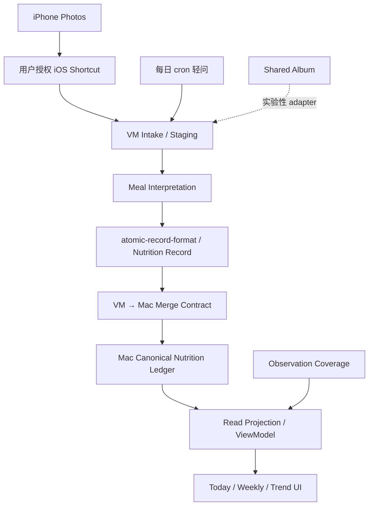

# 营养记餐自动化架构决策｜2026-10-08

> 本文只记录架构、契约、验收与跨仓边界；不包含真实个人饮食数据。

## 1. 结论

主链路：



- iOS Shortcut：主 acquisition 路线。
- 每日 cron：漏记检测 fallback。
- Shared Album：实验性路线，不作为主链。
- Mac ledger：唯一 canonical truth source。
- VM：temporary staging/processing，不创建第二 ledger。
- UI：只消费 projection，不反向写业务 truth。

## 2. 现状证据

2026-10-08 四步核验：
1. media-library 上传库与归档目录均为 0 张；现有 CLI 只覆盖用户上传。
2. iPhone 已有 device 命令没有相册搜索命令。
3. 工具链没有手机直读手柄。
4. 没有可用 iCloud / Google Photos 接口。

因此当前不存在“VM 自己读取 iPhone 相册”的既有技术通道。

2026-10-02 启动的照片流在 2026-10-08 复核时暴露 capture bias：丰盛餐会拍，泡面/鸡翅根/红薯/薯片等随手餐不拍。故仅优化“发图即记”不能解决核心采集问题。

## 3. Acquisition 路线比较

| 路线 | 定位 | 用户成本 | 隐私边界 | 决策 |
|---|---|---|---|---|
| iOS Shortcut | 主链 | 低；目标为自动/极少操作 | 用户显式授权 Shortcut 输出 | P0 |
| 每日 cron 轻问 | fallback | 中；仍需回答 | 不读相册 | P0 |
| Shared Album | 实验 adapter | 中～高；仍需把照片加入共享介质 | 增加复制/共享边界 | P2 |

Shortcut MVP 必须建立 source contract：source / source_asset_id / captured_at / consent_scope / image。

## 4. Nutrition Record Contract

每个 nutrient 必须支持：
- KNOWN_RANGE
- POINT_ESTIMATE
- UNKNOWN

禁止把区间压成伪单值。

推荐最低字段：

```json
{
  "record_id": "uuid",
  "source_asset_id": "sha256-like identity",
  "captured_at": "...",
  "record_type": "meal_nutrition_estimate",
  "schema_version": "1.x",
  "meal": {},
  "nutrients": {},
  "evidence": {},
  "estimate": {
    "status": "estimated",
    "confidence": "medium"
  },
  "coverage": {}
}
```

与 Nutrition #35/#36 的区间估值约束保持一致。

## 5. 达标与风险

达标状态：
- 达标
- 大概率达标
- 可能不足
- 明显不足
- 无法判断

规则：
- 单日偏离 → 轻提示
- 连续偏离 → 升级提示
- 长期模式 → 趋势提醒
- coverage 不足 → 降低结论置信度
- 没有记录不能解释成“没有吃”

热量为方向性照片估算，不得伪装精确。2026 年会议初步结果曾报道消费级照片记餐应用在受控测试中平均每餐低估约 250–345 kcal；不得把该数字当成所有模型的固定误差。

## 6. Persistence / Merge Contract

Mac canonical：/Users/zon/Desktop/MINE/html/nutrition-ledger-mvp

VM 只暂存；真实饮食数据不入 Git。

身份：
- record_id = domain identity
- source_asset_id = ingestion de-duplication

合并：
- 新 record → APPEND
- 相同 source_asset_id → NO-OP
- AI 重估 → revision lineage
- 人工修正优先，不被 AI 覆盖

推荐 MVP 合并时机：每天一次或用户打开 ledger 时显式 merge；不做实时双写。

## 7. Long-term Monitoring

第一版优先 Nutrition ledger 自带 read projection：
- 今日摘要
- 7 日汇总
- observation coverage
- 单日/连续偏离
- 一句综合提示

不先建设第二套 Dashboard truth source。未来若沿用飞书，飞书也只能是 projection consumer。

## 8. Current → Ideal Gap

| 维度 | Current | Ideal | Gate |
|---|---|---|---|
| Source acquisition | 用户主动发图 | Shortcut 低摩擦授权采集 | P0 |
| Capture bias | 随手餐漏记 | 可量化 coverage + fallback | P0 |
| Nutrition estimate | 临场估算 | schema + range + uncertainty | P0 |
| Persistence | Local JSONL | Port + Adapter 可替换 | P1 |
| Writer | Mac canonical | 保持 single writer | 不变 |
| UI | Today-first | Domain → Projection → UI | P1 |
| Long-term | 尚未成形 | weekly projection | P1 |
| Remote DB | 未切换 | 独立 adapter / migration gate | P2 |

## 9. Timeline

- 2026-10-02：照片记餐流启动。
- 2026-10-08：7 天复核发现 capture bias；确认无既有手机相册直读通道。
- 2026-10-08：冻结 passive-intake P0：Shortcut 主路 + cron fallback。
- 下一阶段：acquisition proof → nutrient schema/uncertainty → merge contract → weekly projection。
- acquisition 与 merge contract 未验收前，不切 canonical writer，不建设大 Dashboard。

## 10. Related

- Nutrition: https://github.com/EOMZON/nutrition-ledger-mvp/issues/37
- Nutrition: https://github.com/EOMZON/nutrition-ledger-mvp/issues/38
- Nutrition: https://github.com/EOMZON/nutrition-ledger-mvp/issues/39
- Nutrition: https://github.com/EOMZON/nutrition-ledger-mvp/issues/40
- Parser guard: https://github.com/EOMZON/nutrition-ledger-mvp/issues/35
- Fix PR: https://github.com/EOMZON/nutrition-ledger-mvp/pull/36
- Skills proposal: https://github.com/EOMZON/codex-skills-private/issues/189
- Cross-repo persistence: https://github.com/EOMZON/product-hub/issues/95
- Cross-repo environment contract: https://github.com/EOMZON/product-hub/issues/96
- CreationOS persistence governance: https://github.com/EOMZON/creationos-os/issues/166
- CreationOS D1 governance: https://github.com/EOMZON/creationos-os/issues/25

## 11. 验收原则

实现 Issue 必须逐项提供：
1. exact source / target SHA；
2. runtime command；
3. readback evidence；
4. rollback note；
5. user-visible verification（如涉及 UI）；
6. 明确标注“未验证”的 capability，不得用代码存在/PR merged 推断线上完成。
